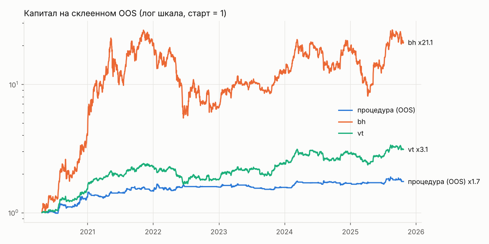

# Эксперимент eth_1d_both

Монеты: ETH/USDT; свечи 1d; направление both. Эталоны bh и vt считаются по тому же портфелю.

Вердикт до holdout: **не найдена**

Сгенерировано 1000 стратегий из 21 семейств; всего проб в журнале на этих данных 4189 (DSR учитывает все). «Не сливают» на всей истории: 605. На фолдах фильтр проходили 438..610.

Склеенный OOS 2010 дней с 2020-04-23: DSR 0.015 (порог 0.95), PBO 0.282, FDR генератора 0.000. ДИ разницы Шарпов: против bh [-1.100, 0.583], против vt [-1.016, 0.571].

Кандидат: `{"confirm": {"family": "donchian", "params": {"n": 10}}, "direction": "both", "family": "macd_zero", "p": null, "params": {"fast": 16, "signal": 9, "slow": 26}, "trend": null, "v": 0.15}`; полная история: Шарп 1.214, MaxDD -12.6%; плато 0.960; переносимость 0.867; стресс пройден.

| curve | sharpe | calmar | max_dd | cagr |
|---|---|---|---|---|
| procedure | 0.873 | 0.982 | -0.109 | 0.107 |
| bh | 1.094 | 0.933 | -0.793 | 0.740 |
| vt | 1.072 | 0.727 | -0.314 | 0.229 |

## Проверки

| check | ok |
|---|---|
| oos_sharpe_above_bh_vt | нет |
| oos_calmar_above_bh_vt | да |
| ci_low_above_0_vs_bh | нет |
| ci_low_above_0_vs_vt | нет |
| dsr | нет |
| pbo | да |
| fdr | да |
| oos_max_dd | да |
| candidate_exists | да |
| plateau | да |
| transfer | да |
| stress | да |
| candidate_max_dd | да |
| candidate_trades_per_month | да |

## Топ-15 по Шарпу на всей истории (in-sample, только для обзора: этот список переобучен)

| spec | family | sharpe_is | cagr_is | max_dd_is | trades_per_month | does_not_lose |
|---|---|---|---|---|---|---|
| {"confirm": {"family": "donchian", "params": {"n": 10}}, "direction": "both", "family": "macd_zero", "p": null, "params": {"fast": 16, "signal": 9, "slow": 26}, "trend": null, "v": 0.15} | macd_zero | 1.214 | 0.150 | -0.126 | 2.503 | True |
| {"confirm": null, "direction": "both", "family": "macd_zero", "p": 0.9, "params": {"fast": 12, "signal": 12, "slow": 26}, "trend": 200, "v": 0.1} | macd_zero | 1.210 | 0.089 | -0.074 | 1.801 | True |
| {"confirm": {"family": "donchian", "params": {"n": 80}}, "direction": "both", "family": "macd_zero", "p": null, "params": {"fast": 16, "signal": 12, "slow": 35}, "trend": null, "v": 0.15} | macd_zero | 1.186 | 0.117 | -0.100 | 1.190 | True |
| {"confirm": null, "direction": "both", "family": "macd_zero", "p": 0.8, "params": {"fast": 16, "signal": 12, "slow": 21}, "trend": 200, "v": 0.25} | macd_zero | 1.182 | 0.206 | -0.181 | 2.157 | True |
| {"confirm": {"family": "rsi_momentum", "params": {"level": 55, "n": 7}}, "direction": "both", "family": "funding_contra", "p": 0.9, "params": {"n": 7, "q": 0.2}, "trend": 200, "v": 0.1} | funding_contra | 1.167 | 0.009 | -0.002 | 0.142 | True |
| {"confirm": {"family": "macd", "params": {"fast": 8, "signal": 9, "slow": 26}}, "direction": "both", "family": "cb_premium", "p": 0.8, "params": {"n": 3, "q": 0.5}, "trend": 100, "v": 0.1} | cb_premium | 1.165 | 0.072 | -0.072 | 2.787 | True |
| {"confirm": null, "direction": "both", "family": "bb_breakout", "p": 0.9, "params": {"k": 1.5, "n": 50}, "trend": 200, "v": 0.15} | bb_breakout | 1.165 | 0.146 | -0.109 | 1.007 | True |
| {"confirm": {"family": "cb_premium", "params": {"n": 3, "q": 0.5}}, "direction": "both", "family": "macd_zero", "p": null, "params": {"fast": 12, "signal": 12, "slow": 26}, "trend": null, "v": 0.2} | macd_zero | 1.153 | 0.163 | -0.153 | 3.327 | True |
| {"confirm": null, "direction": "both", "family": "cci", "p": 0.8, "params": {"level": 100, "n": 14}, "trend": null, "v": 0.25} | cci | 1.119 | 0.198 | -0.275 | 5.605 | True |
| {"confirm": null, "direction": "both", "family": "bb_breakout", "p": 0.9, "params": {"k": 1.0, "n": 30}, "trend": 200, "v": 0.25} | bb_breakout | 1.119 | 0.222 | -0.224 | 1.923 | True |
| {"confirm": null, "direction": "both", "family": "cci", "p": null, "params": {"level": 100, "n": 40}, "trend": 200, "v": 0.1} | cci | 1.106 | 0.075 | -0.069 | 2.207 | True |
| {"confirm": null, "direction": "both", "family": "macd", "p": null, "params": {"fast": 16, "signal": 12, "slow": 26}, "trend": 200, "v": 0.1} | macd | 1.102 | 0.085 | -0.082 | 1.770 | True |
| {"confirm": null, "direction": "both", "family": "cci", "p": null, "params": {"level": 100, "n": 40}, "trend": 200, "v": 0.25} | cci | 1.102 | 0.179 | -0.177 | 2.736 | True |
| {"confirm": null, "direction": "both", "family": "macd_zero", "p": 0.9, "params": {"fast": 16, "signal": 9, "slow": 35}, "trend": 200, "v": 0.1} | macd_zero | 1.095 | 0.081 | -0.072 | 1.617 | True |
| {"confirm": {"family": "rsi_momentum", "params": {"level": 50, "n": 30}}, "direction": "both", "family": "cci", "p": null, "params": {"level": 100, "n": 14}, "trend": null, "v": 0.15} | cci | 1.089 | 0.112 | -0.128 | 4.679 | True |

Полная таблица: exp_eth_1d_both_leaderboard.csv.
