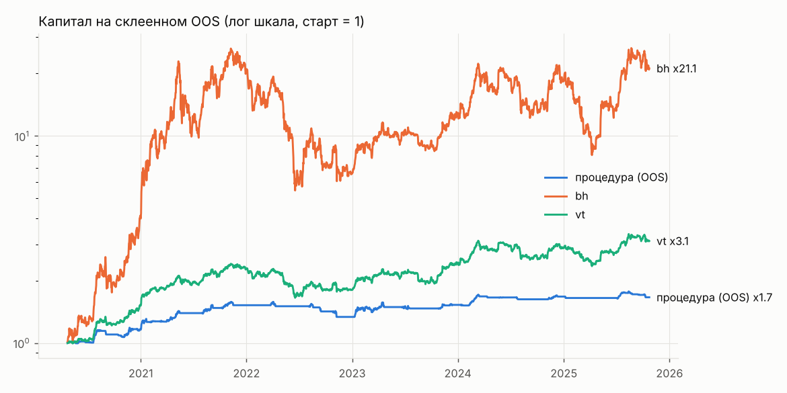

# Эксперимент eth_1d_long

Монеты: ETH/USDT; свечи 1d; направление long. Эталоны bh и vt считаются по тому же портфелю.

Вердикт до holdout: **не найдена**

Сгенерировано 1000 стратегий из 21 семейств; всего проб в журнале на этих данных 3206 (DSR учитывает все). «Не сливают» на всей истории: 690. На фолдах фильтр проходили 340..670.

Склеенный OOS 2010 дней с 2020-04-23: DSR 0.055 (порог 0.95), PBO 0.132, FDR генератора 0.000. ДИ разницы Шарпов: против bh [-0.788, 0.473], против vt [-0.739, 0.484].

Кандидат: `{"confirm": {"family": "donchian", "params": {"n": 10}}, "direction": "long", "family": "macd_zero", "p": null, "params": {"fast": 16, "signal": 9, "slow": 26}, "trend": null, "v": 0.15}`; полная история: Шарп 1.400, MaxDD -9.6%; плато 0.913; переносимость 0.933; стресс пройден.

| curve | sharpe | calmar | max_dd | cagr |
|---|---|---|---|---|
| procedure | 0.961 | 0.631 | -0.154 | 0.097 |
| bh | 1.094 | 0.933 | -0.793 | 0.740 |
| vt | 1.072 | 0.727 | -0.314 | 0.229 |

## Проверки

| check | ok |
|---|---|
| oos_sharpe_above_bh_vt | нет |
| oos_calmar_above_bh_vt | нет |
| ci_low_above_0_vs_bh | нет |
| ci_low_above_0_vs_vt | нет |
| dsr | нет |
| pbo | да |
| fdr | да |
| oos_max_dd | да |
| candidate_exists | да |
| plateau | да |
| transfer | да |
| stress | да |
| candidate_max_dd | да |
| candidate_trades_per_month | да |

## Топ-15 по Шарпу на всей истории (in-sample, только для обзора: этот список переобучен)

| spec | family | sharpe_is | cagr_is | max_dd_is | trades_per_month | does_not_lose |
|---|---|---|---|---|---|---|
| {"confirm": {"family": "donchian", "params": {"n": 10}}, "direction": "long", "family": "macd_zero", "p": null, "params": {"fast": 16, "signal": 9, "slow": 26}, "trend": null, "v": 0.15} | macd_zero | 1.400 | 0.130 | -0.096 | 1.221 | True |
| {"confirm": null, "direction": "long", "family": "macd_zero", "p": 0.9, "params": {"fast": 12, "signal": 12, "slow": 26}, "trend": 200, "v": 0.1} | macd_zero | 1.320 | 0.074 | -0.063 | 0.987 | True |
| {"confirm": null, "direction": "long", "family": "macd_zero", "p": 0.8, "params": {"fast": 16, "signal": 12, "slow": 21}, "trend": 200, "v": 0.25} | macd_zero | 1.315 | 0.179 | -0.161 | 1.129 | True |
| {"confirm": null, "direction": "long", "family": "supertrend", "p": null, "params": {"mult": 2.5, "n": 7}, "trend": 100, "v": 0.2} | supertrend | 1.268 | 0.171 | -0.154 | 1.048 | True |
| {"confirm": null, "direction": "long", "family": "cb_premium", "p": 0.9, "params": {"n": 3, "q": 0.5}, "trend": null, "v": 0.2} | cb_premium | 1.265 | 0.163 | -0.104 | 2.716 | True |
| {"confirm": {"family": "donchian", "params": {"n": 80}}, "direction": "long", "family": "macd_zero", "p": null, "params": {"fast": 16, "signal": 12, "slow": 35}, "trend": null, "v": 0.15} | macd_zero | 1.250 | 0.097 | -0.061 | 0.651 | True |
| {"confirm": null, "direction": "long", "family": "cci", "p": null, "params": {"level": 100, "n": 14}, "trend": null, "v": 0.1} | cci | 1.246 | 0.063 | -0.067 | 2.614 | True |
| {"confirm": null, "direction": "long", "family": "cb_premium", "p": 0.8, "params": {"n": 3, "q": 0.5}, "trend": null, "v": 0.1} | cb_premium | 1.225 | 0.074 | -0.053 | 2.391 | True |
| {"confirm": null, "direction": "long", "family": "macd", "p": null, "params": {"fast": 16, "signal": 12, "slow": 26}, "trend": 200, "v": 0.1} | macd | 1.220 | 0.071 | -0.057 | 1.007 | True |
| {"confirm": null, "direction": "long", "family": "cci", "p": null, "params": {"level": 100, "n": 14}, "trend": null, "v": 0.25} | cci | 1.215 | 0.159 | -0.134 | 3.123 | True |
| {"confirm": null, "direction": "long", "family": "bb_breakout", "p": 0.9, "params": {"k": 1.0, "n": 30}, "trend": 200, "v": 0.25} | bb_breakout | 1.210 | 0.186 | -0.175 | 0.997 | True |
| {"confirm": {"family": "bb_breakout", "params": {"k": 1.0, "n": 30}}, "direction": "long", "family": "macd", "p": null, "params": {"fast": 16, "signal": 9, "slow": 35}, "trend": null, "v": 0.25} | macd | 1.209 | 0.199 | -0.185 | 1.373 | True |
| {"confirm": {"family": "cb_premium", "params": {"n": 3, "q": 0.5}}, "direction": "long", "family": "macd_zero", "p": null, "params": {"fast": 12, "signal": 12, "slow": 26}, "trend": null, "v": 0.2} | macd_zero | 1.199 | 0.117 | -0.123 | 1.465 | True |
| {"confirm": {"family": "rsi_momentum", "params": {"level": 50, "n": 30}}, "direction": "long", "family": "cci", "p": null, "params": {"level": 100, "n": 14}, "trend": null, "v": 0.15} | cci | 1.195 | 0.087 | -0.085 | 2.553 | True |
| {"confirm": null, "direction": "long", "family": "macd", "p": 0.9, "params": {"fast": 16, "signal": 12, "slow": 26}, "trend": 200, "v": 0.15} | macd | 1.191 | 0.103 | -0.085 | 1.119 | True |

Полная таблица: exp_eth_1d_long_leaderboard.csv.
