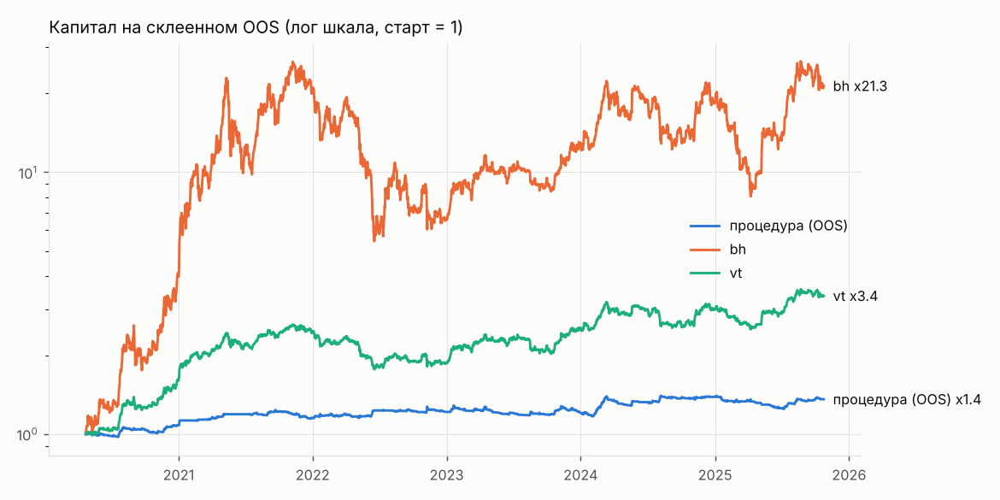

# Эксперимент eth_6h_both

Монеты: ETH/USDT; свечи 6h; направление both. Эталоны bh и vt считаются по тому же портфелю.

Вердикт до holdout: **не найдена**

Сгенерировано 1000 стратегий из 21 семейств; всего проб в журнале на этих данных 5184 (DSR учитывает все). «Не сливают» на всей истории: 590. На фолдах фильтр проходили 463..580.

Склеенный OOS 2011 дней с 2020-04-23: DSR 0.002 (порог 0.95), PBO 0.141, FDR генератора 0.000. ДИ разницы Шарпов: против bh [-1.304, 0.554], против vt [-1.264, 0.487].

Кандидат: `{"confirm": null, "direction": "both", "family": "macd_zero", "p": null, "params": {"fast": 12, "signal": 12, "slow": 26}, "trend": 200, "v": 0.1}`; полная история: Шарп 1.398, MaxDD -8.4%; плато 0.892; переносимость 1.000; стресс не пройден.

| curve | sharpe | calmar | max_dd | cagr |
|---|---|---|---|---|
| procedure | 0.750 | 0.523 | -0.110 | 0.058 |
| bh | 1.096 | 0.936 | -0.793 | 0.742 |
| vt | 1.118 | 0.757 | -0.326 | 0.247 |

## Проверки

| check | ok |
|---|---|
| oos_sharpe_above_bh_vt | нет |
| oos_calmar_above_bh_vt | нет |
| ci_low_above_0_vs_bh | нет |
| ci_low_above_0_vs_vt | нет |
| dsr | нет |
| pbo | да |
| fdr | да |
| oos_max_dd | да |
| candidate_exists | да |
| plateau | да |
| transfer | да |
| stress | нет |
| candidate_max_dd | да |
| candidate_trades_per_month | да |

## Топ-15 по Шарпу на всей истории (in-sample, только для обзора: этот список переобучен)

| spec | family | sharpe_is | cagr_is | max_dd_is | trades_per_month | does_not_lose |
|---|---|---|---|---|---|---|
| {"confirm": null, "direction": "both", "family": "macd_zero", "p": 0.9, "params": {"fast": 12, "signal": 12, "slow": 26}, "trend": 200, "v": 0.1} | macd_zero | 1.398 | 0.096 | -0.084 | 5.308 | True |
| {"confirm": null, "direction": "both", "family": "supertrend", "p": 0.8, "params": {"mult": 3.0, "n": 14}, "trend": 200, "v": 0.15} | supertrend | 1.374 | 0.170 | -0.104 | 2.807 | True |
| {"confirm": null, "direction": "both", "family": "bb_breakout", "p": 0.9, "params": {"k": 2.0, "n": 20}, "trend": 200, "v": 0.2} | bb_breakout | 1.341 | 0.192 | -0.128 | 4.302 | True |
| {"confirm": null, "direction": "both", "family": "cci", "p": null, "params": {"level": 100, "n": 40}, "trend": 200, "v": 0.1} | cci | 1.332 | 0.084 | -0.084 | 5.308 | True |
| {"confirm": null, "direction": "both", "family": "bb_breakout", "p": 0.9, "params": {"k": 1.5, "n": 50}, "trend": 200, "v": 0.15} | bb_breakout | 1.324 | 0.155 | -0.109 | 2.797 | True |
| {"confirm": null, "direction": "both", "family": "bb_breakout", "p": null, "params": {"k": 2.0, "n": 20}, "trend": 200, "v": 0.1} | bb_breakout | 1.322 | 0.098 | -0.069 | 3.712 | True |
| {"confirm": null, "direction": "both", "family": "macd", "p": null, "params": {"fast": 16, "signal": 12, "slow": 26}, "trend": 200, "v": 0.1} | macd | 1.322 | 0.103 | -0.105 | 5.847 | True |
| {"confirm": null, "direction": "both", "family": "bb_breakout", "p": 0.8, "params": {"k": 2.0, "n": 10}, "trend": 200, "v": 0.1} | bb_breakout | 1.315 | 0.079 | -0.097 | 5.420 | True |
| {"confirm": null, "direction": "both", "family": "bb_breakout", "p": 0.8, "params": {"k": 1.0, "n": 20}, "trend": 200, "v": 0.1} | bb_breakout | 1.309 | 0.104 | -0.088 | 5.776 | True |
| {"confirm": {"family": "cci", "params": {"level": 100, "n": 40}}, "direction": "both", "family": "supertrend", "p": 0.9, "params": {"mult": 3.0, "n": 10}, "trend": 200, "v": 0.2} | supertrend | 1.304 | 0.166 | -0.156 | 5.563 | True |
| {"confirm": null, "direction": "both", "family": "supertrend", "p": null, "params": {"mult": 3.0, "n": 10}, "trend": 200, "v": 0.2} | supertrend | 1.294 | 0.219 | -0.125 | 2.969 | True |
| {"confirm": null, "direction": "both", "family": "macd", "p": 0.9, "params": {"fast": 16, "signal": 12, "slow": 26}, "trend": 200, "v": 0.15} | macd | 1.294 | 0.155 | -0.158 | 6.498 | True |
| {"confirm": {"family": "macd", "params": {"fast": 16, "signal": 9, "slow": 35}}, "direction": "both", "family": "ema_cross", "p": 0.9, "params": {"fast": 20, "slow": 150}, "trend": null, "v": 0.15} | ema_cross | 1.282 | 0.150 | -0.127 | 6.966 | True |
| {"confirm": null, "direction": "both", "family": "supertrend", "p": null, "params": {"mult": 3.0, "n": 20}, "trend": 200, "v": 0.25} | supertrend | 1.272 | 0.262 | -0.168 | 3.203 | True |
| {"confirm": null, "direction": "both", "family": "macd", "p": 0.8, "params": {"fast": 12, "signal": 9, "slow": 35}, "trend": 200, "v": 0.25} | macd | 1.269 | 0.244 | -0.236 | 7.241 | True |

Полная таблица: exp_eth_6h_both_leaderboard.csv.
