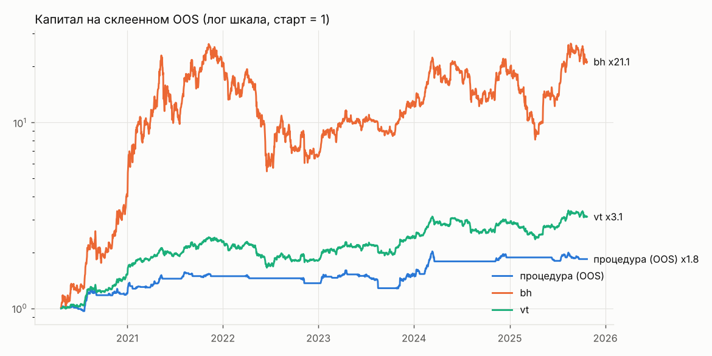

# Генератор стратегий: отбор

Вердикт до holdout: **не найдена**

Сгенерировано 2000 стратегий из 13 семейств; всего проб в журнале на этих данных 2300 (DSR учитывает все). «Не сливают» на всей истории: 1531. На фолдах фильтр проходили 1264..1494.

Склеенный OOS 2010 дней с 2020-04-23: DSR 0.057 (порог 0.95), PBO 0.516, FDR генератора 0.000. ДИ разницы Шарпов: против bh [-1.020, 0.479], против vt [-0.904, 0.407].

Кандидат: `{"confirm": {"family": "supertrend", "params": {"mult": 2.5, "n": 10}}, "family": "donchian", "p": null, "params": {"n": 80}, "trend": null, "v": 0.2}`; полная история: Шарп 1.471, MaxDD -9.4%; плато 0.868; переносимость 1.000; стресс пройден.

| curve | sharpe | calmar | max_dd | cagr |
|---|---|---|---|---|
| procedure | 0.834 | 0.580 | -0.202 | 0.117 |
| bh | 1.094 | 0.933 | -0.793 | 0.740 |
| vt | 1.072 | 0.727 | -0.314 | 0.229 |

## Проверки

| check | ok |
|---|---|
| oos_sharpe_above_bh_vt | нет |
| oos_calmar_above_bh_vt | нет |
| ci_low_above_0_vs_bh | нет |
| ci_low_above_0_vs_vt | нет |
| dsr | нет |
| pbo | нет |
| fdr | да |
| oos_max_dd | да |
| oos_trades_per_month | да |
| candidate_exists | да |
| plateau | да |
| transfer | да |
| stress | да |
| candidate_max_dd | да |
| candidate_trades_per_month | да |

## Топ-15 по Шарпу на всей истории (in-sample, только для обзора: этот список переобучен)

| spec | family | sharpe_is | cagr_is | max_dd_is | trades_per_month | does_not_lose |
|---|---|---|---|---|---|---|
| {"confirm": {"family": "supertrend", "params": {"mult": 2.5, "n": 10}}, "family": "donchian", "p": 0.8, "params": {"n": 80}, "trend": null, "v": 0.2} | donchian | 1.439 | 0.178 | -0.094 | 0.468 | True |
| {"confirm": null, "family": "cci", "p": null, "params": {"level": 100, "n": 14}, "trend": null, "v": 0.2} | cci | 1.419 | 0.159 | -0.108 | 3.367 | True |
| {"confirm": null, "family": "cci", "p": 0.9, "params": {"level": 100, "n": 14}, "trend": null, "v": 0.15} | cci | 1.414 | 0.117 | -0.082 | 3.265 | True |
| {"confirm": {"family": "macd", "params": {"fast": 16, "signal": 12, "slow": 21}}, "family": "cci", "p": null, "params": {"level": 100, "n": 14}, "trend": null, "v": 0.15} | cci | 1.397 | 0.111 | -0.077 | 3.001 | True |
| {"confirm": null, "family": "cci", "p": 0.9, "params": {"level": 100, "n": 14}, "trend": null, "v": 0.2} | cci | 1.391 | 0.155 | -0.108 | 3.306 | True |
| {"confirm": null, "family": "cci", "p": 0.8, "params": {"level": 100, "n": 14}, "trend": null, "v": 0.15} | cci | 1.387 | 0.113 | -0.099 | 3.143 | True |
| {"confirm": null, "family": "cci", "p": null, "params": {"level": 100, "n": 14}, "trend": null, "v": 0.25} | cci | 1.385 | 0.193 | -0.134 | 3.377 | True |
| {"confirm": null, "family": "macd_zero", "p": null, "params": {"fast": 16, "signal": 12, "slow": 21}, "trend": 200, "v": 0.1} | macd_zero | 1.377 | 0.078 | -0.067 | 0.926 | True |
| {"confirm": null, "family": "bb_breakout", "p": null, "params": {"k": 1.0, "n": 30}, "trend": null, "v": 0.25} | bb_breakout | 1.370 | 0.267 | -0.233 | 1.404 | True |
| {"confirm": null, "family": "cci", "p": 0.8, "params": {"level": 100, "n": 14}, "trend": null, "v": 0.2} | cci | 1.364 | 0.149 | -0.130 | 3.184 | True |
| {"confirm": {"family": "cci", "params": {"level": 100, "n": 14}}, "family": "rsi_momentum", "p": 0.8, "params": {"level": 50, "n": 7}, "trend": null, "v": 0.25} | rsi_momentum | 1.360 | 0.185 | -0.161 | 3.184 | True |
| {"confirm": {"family": "macd", "params": {"fast": 16, "signal": 5, "slow": 35}}, "family": "rsi_momentum", "p": 0.9, "params": {"level": 55, "n": 21}, "trend": null, "v": 0.2} | rsi_momentum | 1.359 | 0.167 | -0.144 | 1.974 | True |
| {"confirm": null, "family": "cci", "p": 0.8, "params": {"level": 100, "n": 14}, "trend": null, "v": 0.25} | cci | 1.353 | 0.184 | -0.161 | 3.184 | True |
| {"confirm": {"family": "macd_zero", "params": {"fast": 16, "signal": 5, "slow": 35}}, "family": "cci", "p": 0.9, "params": {"level": 100, "n": 14}, "trend": null, "v": 0.15} | cci | 1.344 | 0.096 | -0.055 | 2.340 | True |
| {"confirm": {"family": "donchian", "params": {"n": 80}}, "family": "macd_zero", "p": 0.8, "params": {"fast": 16, "signal": 12, "slow": 21}, "trend": null, "v": 0.1} | macd_zero | 1.339 | 0.070 | -0.043 | 0.702 | True |

Полная таблица: generator_leaderboard.csv.
