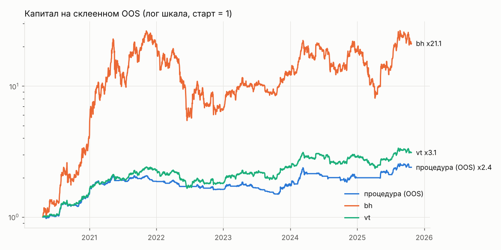
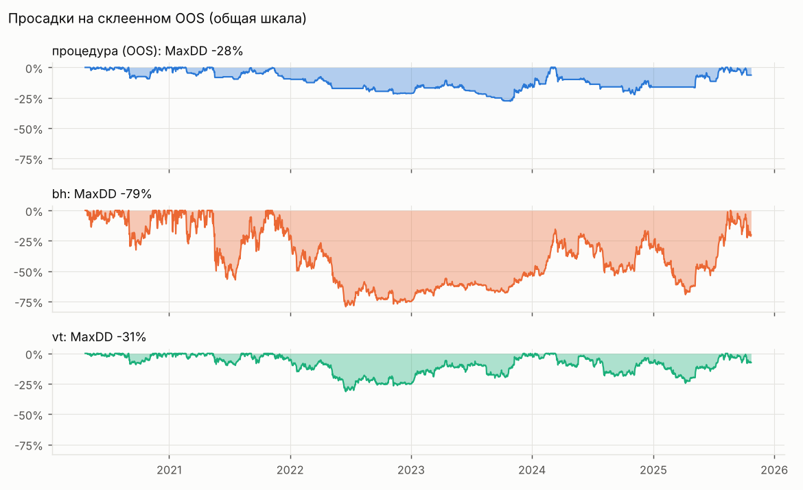
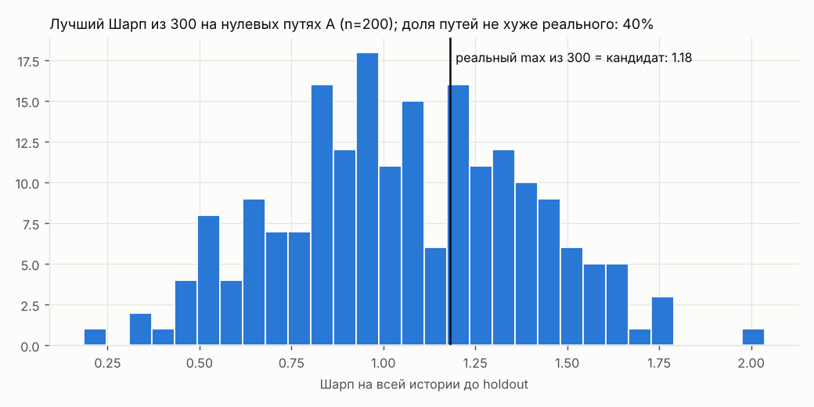
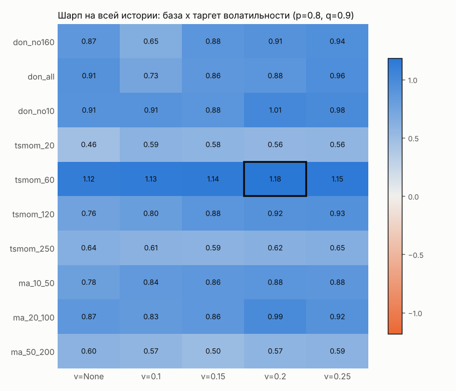

# tradelab: отчёт

**Вердикт до holdout: не найдена.** Holdout (2025-10-25 и далее) не тронут.

## Числа

- N проб на реальных данных: 300; данные ETH/USDT 2017-08-17 .. 2025-10-24, sha256 набора `538ac46951f815fd…`.
- Склеенный OOS: 2010 дней с 2020-04-23, фолдов: 23.
- DSR 0.896 (порог 0.95), PBO 0.838 (порог 0.5), FDR на путях A 0.000 (порог 0.05), мощность при phi=0.20 0.015.
- ДИ 90% разницы Шарпов: против bh [-0.64, 0.43], против vt [-0.56, 0.42].
- Лучший Шарп из 300 на реальных данных 1.18; на нулевых путях A такой или выше в 40% случаев.
- Месяцы с доходностью > 20% на склеенном OOS (подозрение на подгонку): нет.

## Склеенный OOS против эталонов

| curve | cagr | calmar | max_dd | sharpe |
|---|---|---|---|---|
| procedure | 0.172 | 0.619 | -0.278 | 1.035 |
| bh | 0.740 | 0.933 | -0.793 | 1.094 |
| vt | 0.229 | 0.727 | -0.314 | 1.072 |

## По режимам (OOS дни)

| regime | curve | days | sharpe | calmar | max_dd | cagr |
|---|---|---|---|---|---|---|
| bear_2018 | procedure | 0 | нет OOS |  |  |  |
| bear_2018 | bh | 0 | нет OOS |  |  |  |
| bear_2018 | vt | 0 | нет OOS |  |  |  |
| bull_2020_21 | procedure | 567 | 2.61 | 6.04 | -9.8% | 59.1% |
| bull_2020_21 | bh | 567 | 2.62 | 12.25 | -57.2% | 701.0% |
| bull_2020_21 | vt | 567 | 2.87 | 7.58 | -9.9% | 75.3% |
| bear_2022 | procedure | 416 | -1.99 | -0.86 | -21.6% | -18.6% |
| bear_2022 | bh | 416 | -0.95 | -0.88 | -78.9% | -69.5% |
| bear_2022 | vt | 416 | -1.03 | -0.70 | -31.1% | -21.9% |
| recovery | procedure | 1027 | 0.87 | 0.66 | -22.4% | 14.8% |
| recovery | bh | 1027 | 0.97 | 0.81 | -63.8% | 51.6% |
| recovery | vt | 1027 | 1.00 | 0.87 | -24.6% | 21.3% |

## Нулевое распределение лучшего Шарпа

## Плато

Кандидат `tsmom_60|v=0.2|p=0.8|q=0.9`, после абляции `tsmom_60|v=None|p=0.8|q=0.9`; плато 0.662 (порог 0.7); переносимость 0.87; стресс пройден.

## Проверки (раздел 13 без holdout)

| check | ok |
|---|---|
| candidate_exists | да |
| candidate_max_dd | нет |
| candidate_trades_per_month | да |
| ci_low_above_0_vs_bh | нет |
| ci_low_above_0_vs_vt | нет |
| dsr | нет |
| fdr | да |
| oos_calmar_above_bh_vt | нет |
| oos_max_dd | нет |
| oos_sharpe_above_bh_vt | нет |
| oos_trades_per_month | да |
| pbo | нет |
| plateau | нет |
| stress | да |
| transfer | да |

## Абляция

| kept | layer | with | without |
|---|---|---|---|
| False | v | 1.291 | 1.364 |
| True | p | 1.364 | 1.149 |
| True | q | 1.364 | 1.255 |

## Переносимость на корзину

| coin | net_return |
|---|---|
| AAVE/USDT | 51.6% |
| ADA/USDT | 39.8% |
| AVAX/USDT | 6171.4% |
| BNB/USDT | 541.7% |
| BTC/USDT | 1256.8% |
| DOGE/USDT | -72.2% |
| HBAR/USDT | 249.2% |
| LINK/USDT | 893.0% |
| LTC/USDT | 15.3% |
| NEAR/USDT | 565.0% |
| SOL/USDT | 5027.6% |
| TRX/USDT | 453.7% |
| UNI/USDT | 338.2% |
| XLM/USDT | -91.4% |
| XRP/USDT | 46.9% |

## Стилизованные факты: реальные против синтетики B

| fact | real | synth_B_mean | synth_B_p05 | synth_B_p95 |
|---|---|---|---|---|
| kurtosis | 14.886 | 45.636 | 15.715 | 117.575 |
| hill_top5 | 3.173 | 2.135 | 1.479 | 2.585 |
| acf_abs_1 | 0.163 | 0.249 | 0.128 | 0.443 |
| acf_abs_10 | 0.093 | 0.203 | 0.096 | 0.342 |
| acf_abs_50 | 0.032 | 0.087 | 0.008 | 0.232 |
| acf_r_1 | -0.063 | 0.002 | -0.068 | 0.075 |
| corr_r_absnext | -0.071 | -0.002 | -0.081 | 0.083 |

## Выбор по фолдам

tsmom_60|v=0.2|p=None|q=None, tsmom_60|v=0.2|p=None|q=None, tsmom_60|v=0.2|p=None|q=None, tsmom_20|v=0.15|p=None|q=None, tsmom_20|v=0.15|p=None|q=None, tsmom_20|v=0.15|p=None|q=None, tsmom_20|v=0.15|p=None|q=None, tsmom_20|v=0.15|p=None|q=None, tsmom_60|v=0.2|p=0.8|q=0.9, tsmom_60|v=0.2|p=0.8|q=0.9, don_no160|v=0.2|p=None|q=None, don_no160|v=0.2|p=None|q=None, don_no160|v=0.25|p=None|q=None, don_no160|v=0.25|p=None|q=None, ma_10_50|v=0.25|p=None|q=None, ma_10_50|v=0.25|p=None|q=None, ma_10_50|v=0.25|p=None|q=None, ma_10_50|v=0.25|p=None|q=None, ma_10_50|v=0.25|p=None|q=None, ma_10_50|v=0.25|p=None|q=None, ma_10_50|v=0.25|p=None|q=None, tsmom_60|v=0.2|p=0.8|q=0.9, tsmom_60|v=0.2|p=0.8|q=0.9

## Ограничения

- Смещение выживших в корзине: кандидаты отобраны среди пар, которые торгуются сейчас, по текущему 24ч объёму.
- Мало режимов: в истории ETH два медвежьих и один бычий цикл; склеенный OOS начинается 2020-04-23 и не видит 2018.
- Фандинг до начала архива (2020-01) и после его конца (2026-09) взят константой 3 x 0.0001 в сутки.
- Спот загружен через официальное зеркало Binance data-api.binance.vision, фандинг из архива data.binance.vision (api.binance.com недоступен, 451).
- Мощность процедуры низкая: при AR(1) phi = 0.20 находка на 1.5% путей C; «не найдена» не доказывает отсутствие слабого сигнала.
- Синтетика B даёт хвосты тяжелее реальных (эксцесс и индекс Хилла в таблице фактов), поэтому её стресс строже реальности.
- Издержки: фиксированная модель комиссии и проскальзывания на 10 000 USD; стакан и задержки API не моделируются.
